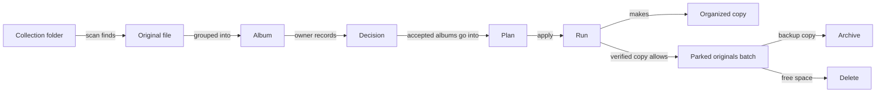
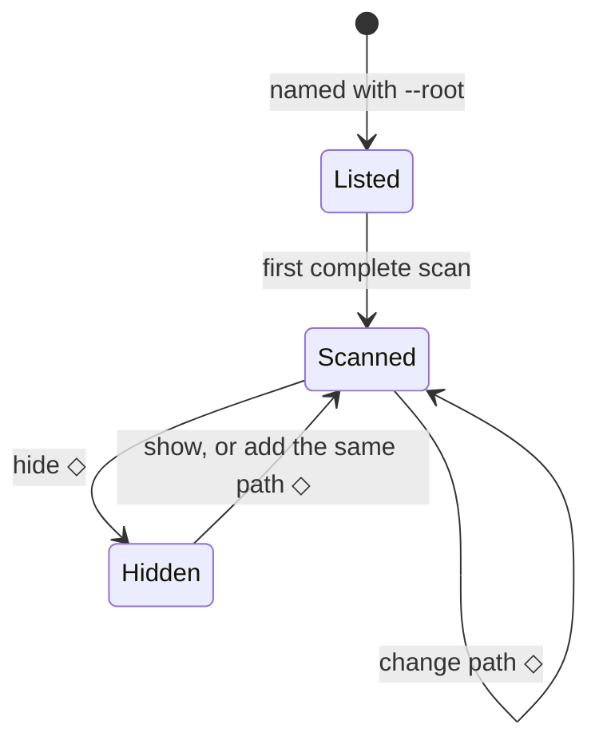
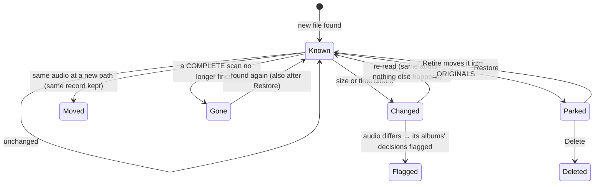
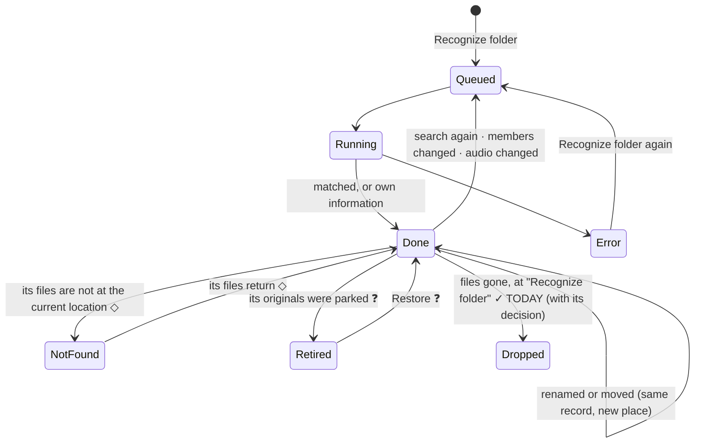
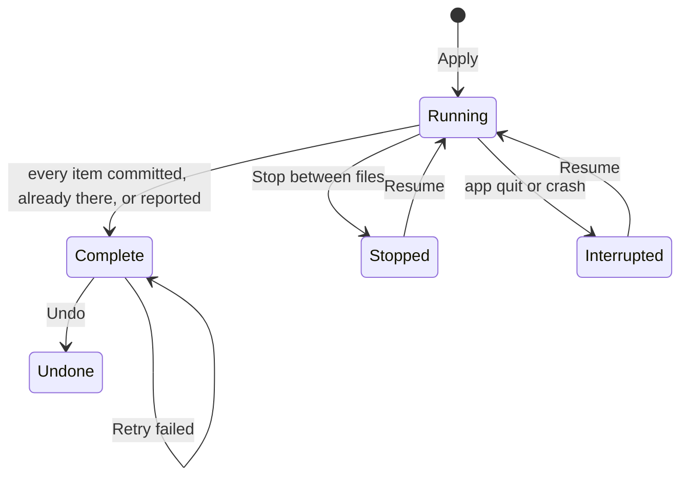
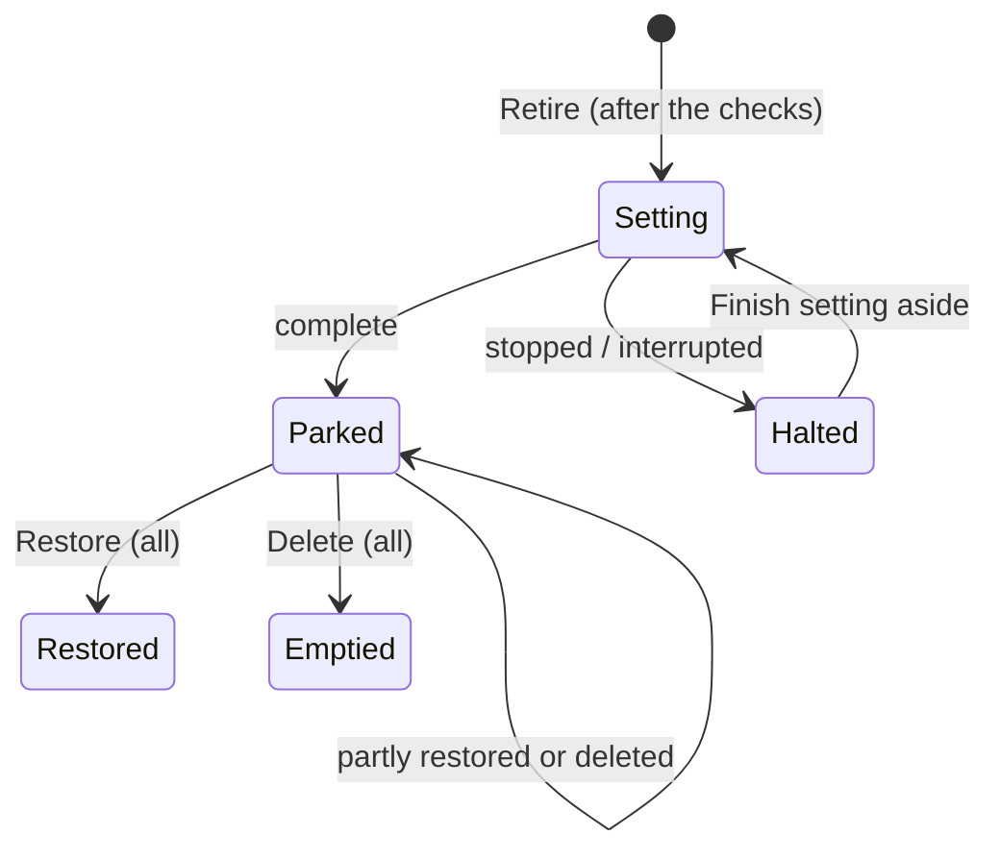

# Lifecycles

How each object in Music Steward is born, changes and ends: its **states**, the **events** that move it between
them, what **must never** happen, and how an event on one object reaches the others. Words are those of the
[glossary](../GLOSSARY.md). ✓ = exists today · ◇ = decided in [ADR 0004](adr/0004-collection-folders.md) but not built
· ❓ = an open question (listed at the end).

This is a map of the whole, so the next feature is checked against it instead of discovering the interactions one
review round at a time.

## The objects and how they hang together

Everything left of the plan belongs to one collection folder; the plan, run and copies belong to a destination folder.

## 1. Collection folder

States ✓ *Listed* (named on the command line, never scanned) → *Scanned* (at least one complete scan). ◇ *Hidden*.
*Connected / not connected* is not a stored state: it is observed each time (a drive can drop in the middle of anything).

| Event | By | Effect |
|---|---|---|
| Listed ✓ / Added ◇ | owner | registered only; nothing read, nothing scanned; Retire off |
| Scanned ✓ | owner | inventory refreshed; an *aborted* or *interrupted* scan marks nothing removed |
| Disconnected / reconnected ✓ (observed) | the drive | ◇ shown as *not connected*, writing actions disabled, nothing removed |
| Retire allowed / not allowed ✓ | owner | per folder, off by default |
| Path changed ◇ | owner | same collection, new path: decisions kept, Retire back to off, history entry |
| Hidden / shown ◇ | owner | stop / resume showing and scanning; everything kept |

**Never:** the app writes to it (except the fenced *Retire*); removes it by itself; lets two collection folders overlap ◇.

## 2. Original file

**Never:** marked *gone* by a scan that did not finish, or while its drive is not connected.

## 3. Album

States ✓ *Queued* → *Running* → *Done* | *Error*. ◇ *Not found*. ❓ *Retired*.

**Today** an album whose files are gone is *dropped together with its decision* the next time "Recognize folder" runs.
Checked on 2026-11-21 on a scratch collection: **Retire → rescan → Recognize folder took 2 albums and 2 decisions to 0
and 0.** [ADR 0004](adr/0004-collection-folders.md) rule 7 (*not found*, never dropped) fixes the general case; it
does not say what an album whose originals were *deliberately* parked should be — see ❓ Q-L1.

## 4. Decision

States ✓ *Undecided* → *Accepted* (a catalogue match, or the album's own information) | *Skipped*; ✓ *Accepted but
flagged* ("audio changed").

| Event | Effect |
|---|---|
| Accepted / Skipped / Cleared | by the owner, one album or the exactly-selected albums; a folder-wide action touches only the undecided |
| Edited | name, year, disc, track titles — used exactly as typed |
| Kept through a re-match | only if the same release is still a candidate; otherwise cleared with a notice |
| Flagged ✓ | audio or cue sheet changed since: kept, left out of plans, album queued again |
| Re-accepted | clears the flag |

**Never:** changed by a re-match or a bulk action the owner did not aim at it; dropped only because files are missing ◇.

## 5. Plan

*Built* (frozen: each item `ok`, blocked, a duplicate copied once, or source changed) → *Applied* by one or more runs.
Building changes nothing on disk. Albums flagged "audio changed" are listed as *left out*. Plans are kept, never edited.

## 6. Run and organized copy

Per file: *intent → copied → tagged → published → committed* (or `conflict`, `already existed`, `aborted…`, `failed`).
**Never:** a file under a final name that is incomplete; an overwrite; an undo that removes a file the owner changed.

## 7. Batch of parked originals

Per file: *intent → (claimed) → moved* → *restored* | *deleting → deleted*; or *skipped / conflict / missing*.
**Never:** across a link, a device or a changed collection folder; a replace; a delete without the typed word and the
repeated checks.

## 8. Archive and 9. Delete (of a batch)

**Archive:** *Running → Stopped → Complete*, and Complete is *verified* only if every file was checked; a verified
archive is *invalidated* if a file later goes missing (observed, not stored). **Delete:** *Confirmed → Running →
Stopped → Complete* with some albums *kept* when their checks fail. Neither changes anything but the batch.

## How an event on one object reaches the others

| Event | Reaches |
|---|---|
| Scan: content changed | file *Changed* → album *Queued*, its decision *Flagged*, the plan leaves it out |
| Scan: folder renamed or moved | file *Moved* → album re-keyed, decision kept |
| Scan: files gone (complete scan) | file *Gone* → album *Not found*, decision kept ◇ (today: dropped at Recognize) |
| Drive not connected | collection folder *not connected* → writing actions disabled; nothing is marked gone |
| Run undone | the organized copies go → the run's parked batches can no longer be archived or deleted |
| Retire | files *Parked* → ❓ album state (see below); the next scan sees the files as gone |
| Restore | files return → album back to *Done*, decision intact |
| Change path ◇ | blocked while a run is unfinished or originals are parked; otherwise decisions stay, Retire off |

## Open questions

* ❓ **Q-L1 — what is an album whose originals were parked?** *Not found* would be wrong (nothing is lost, it is
  organized). Proposed: a distinct state **Retired** with its decision kept, shown as "Organized · originals set
  aside", leaving it out of "Recognize" and "plans", and returning to *Done* on Restore. After Delete: *Retired —
  originals deleted* (final).
* ❓ **Q-L2 — a history of events.** Keep one list of lifecycle events (path changed, run applied or undone,
  originals retired / restored / archived / deleted) that the owner can read, or only the per-object records that
  exist now?
* ❓ **Q-L3 — when does a *not found* album end?** Never by itself; the owner discards it. Is "discard" an action
  on one album, on all not-found albums of a folder, or both?
