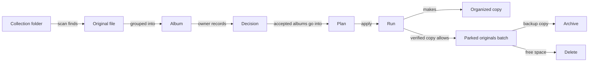
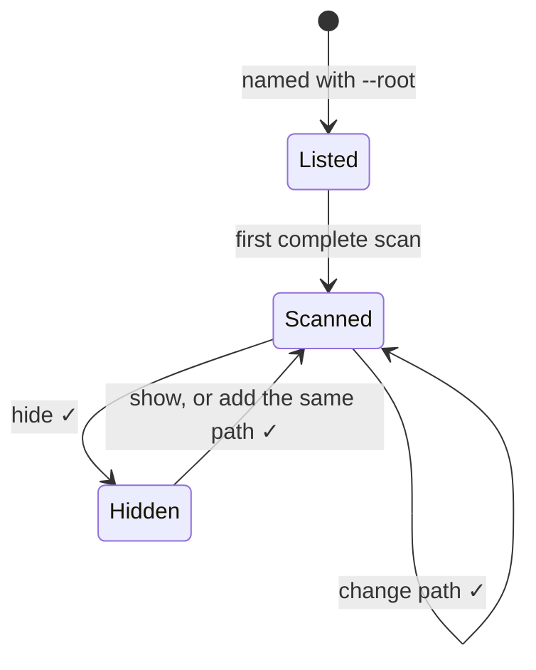
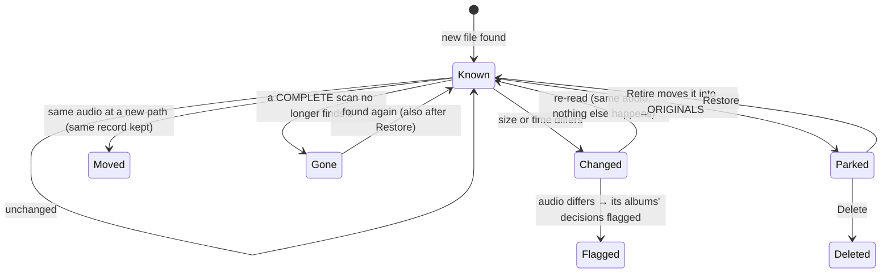
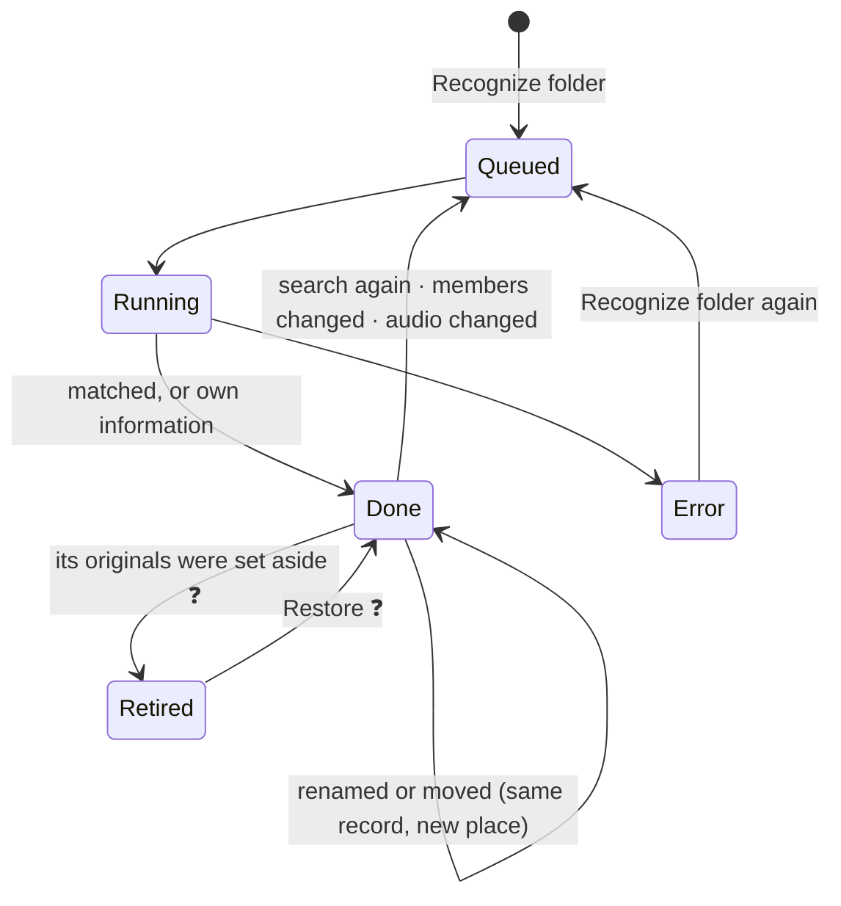
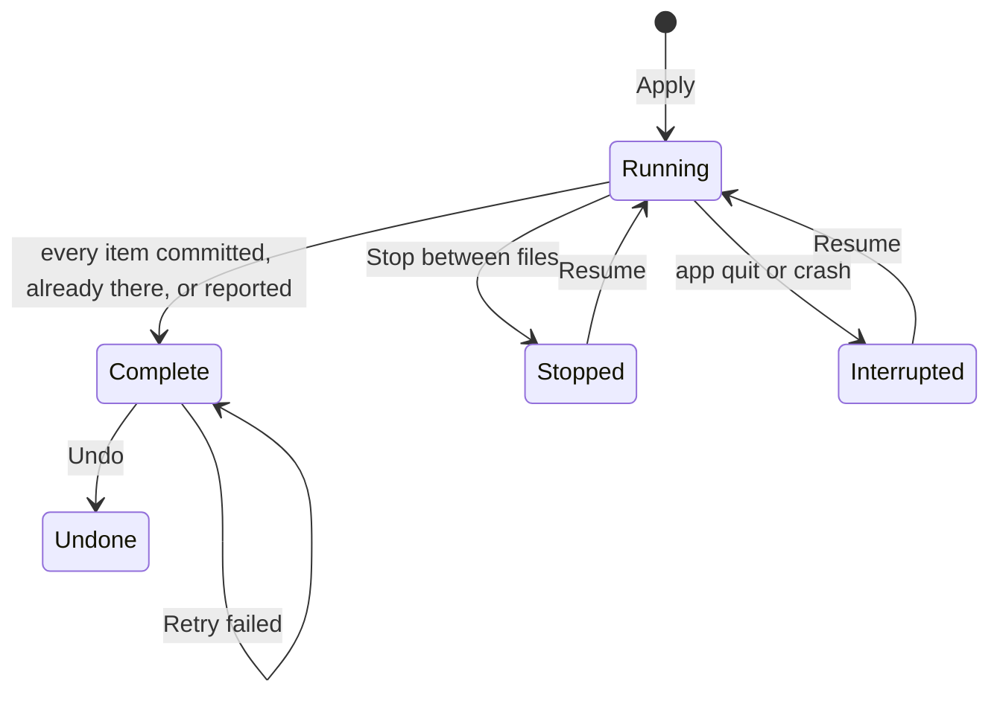
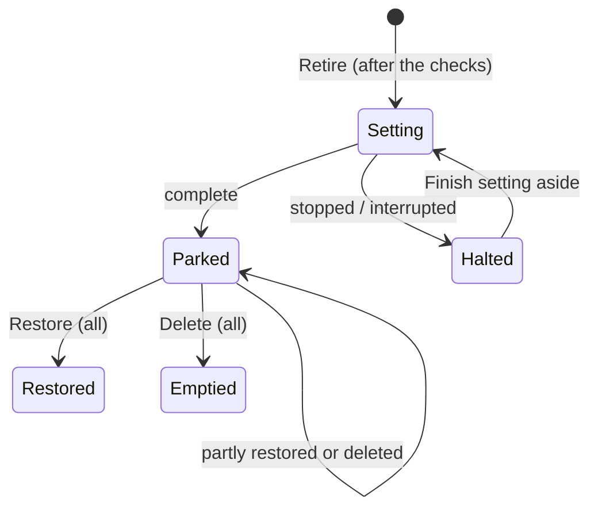

# Lifecycles

How each object in Music Steward is born, changes and ends: its **states**, the **events** that move it between
them, what **must never** happen, and how an event on one object reaches the others. Words are those of the
[glossary](../GLOSSARY.md). ✓ = exists today · ◇ = decided in [ADR 0004](adr/0004-collection-folders.md) but not built
· ❓ = an open question (listed at the end).

This is a map of the whole, so the next feature is checked against it instead of discovering the interactions one
review round at a time.

## The objects and how they hang together

Everything left of the plan belongs to one collection folder; the plan, run and copies belong to a destination folder.

## 1. Collection folder

States ✓ *Listed* (added, or named on the command line; never scanned) → *Scanned* (at least one complete scan). ✓ *Hidden*.
*Connected / not connected* is not a stored state: it is observed each time (a drive can drop in the middle of anything).

| Event | By | Effect |
|---|---|---|
| Listed ✓ / Added ✓ | owner | registered only; nothing read, nothing scanned; Retire off |
| Scanned ✓ | owner | inventory refreshed; an *aborted* or *interrupted* scan marks nothing removed |
| Disconnected / reconnected ✓ (observed) | the drive | shown as *not connected* (with the share's new mount point, if it has one), every action that reads it disabled, nothing removed |
| Retire allowed / not allowed ✓ | owner | per folder, off by default |
| Path changed ✓ | owner | same collection, new path: decisions kept, Retire back to off, history entry; plans made before it are not applied |
| Hidden / shown ✓ | owner | stop / resume showing and scanning; everything kept |

**Never:** the app writes to it (except the fenced *Retire*); removes it by itself; lets two collection folders overlap.

## 2. Original file

**Never:** marked *gone* by a scan that did not finish, or while its drive is not connected.

## 3. Album

States ✓ *Queued* → *Running* → *Done* | *Error*, and *Retired* ❓ once its originals are set aside.
**Not found is not a state.** It is an *exception* (a warning) raised on an album or a collection folder when the files
are not at the current location; it never changes the album's state or its decision, and it clears by itself when the
files return. Likewise **No match** is a normal outcome of recognition (no online release): the album stays *Done* once
the owner accepts its own information, or waits for a decision.

| Exception | Raised when | Effect | Cleared |
|---|---|---|---|
| Not found ✓ | a complete scan finds none of the album's files at the location (and they are not parked) | shown as a warning; plans leave it out; nothing else changes | its files return, or the owner confirms *Remove…* (or leaves it for now) |
| Audio changed ✓ | the audio or cue sheet differs from what was decided on | decision kept but flagged; left out of plans; queued again | the owner accepts again |
| Not connected ✓ | the collection folder's drive or share is not available | writing actions disabled; nothing is marked | it is connected again |

**Fixed (this PR's predecessor of the full feature):** an album whose files are gone is no longer dropped with its decision
at "Recognize folder". It shows *Originals set aside* (Retire) or *Not found*, and plans skip it. Before the fix, on 2026-11-21,
**Retire → rescan → Recognize folder took 2 albums and 2 decisions to 0 and 0.** *Leave for now / Remove…* and the
history were built since. [ADR 0004](adr/0004-collection-folders.md) rule 7 fixes this: the album is never dropped. Albums whose
originals are parked are not *not found* at all: they are *Retired* (decided below).

## 4. Decision

States ✓ *Undecided* → *Accepted* (a catalogue match, or the album's own information) | *Skipped*; ✓ *Accepted but
flagged* ("audio changed").

| Event | Effect |
|---|---|
| Accepted / Skipped / Cleared | by the owner, one album or the exactly-selected albums; a folder-wide action touches only the undecided |
| Edited | name, year, disc, track titles — used exactly as typed |
| Kept through a re-match | only if the same release is still a candidate; otherwise cleared with a notice |
| Flagged ✓ | audio or cue sheet changed since: kept, left out of plans, album queued again |
| Re-accepted | clears the flag |

**Never:** changed by a re-match or a bulk action the owner did not aim at it; dropped only because files are missing.

## 5. Plan

*Built* (frozen: each item `ok`, blocked, a duplicate copied once, or source changed) → *Applied* by one or more runs.
Building changes nothing on disk. Albums flagged "audio changed" are listed as *left out*. Plans are kept, never edited.

## 6. Run and organized copy

Per file: *intent → copied → tagged → published → committed* (or `conflict`, `already existed`, `aborted…`, `failed`).
**Never:** a file under a final name that is incomplete; an overwrite; an undo that removes a file the owner changed.

## 7. Batch of parked originals

Per file: *intent → (claimed) → moved* → *restored* | *deleting → deleted*; or *skipped / conflict / missing*.
**Never:** across a link, a device or a changed collection folder; a replace; a delete without the typed word and the
repeated checks.

## 8. Archive and 9. Delete (of a batch)

**Archive:** *Running → Stopped → Complete*, and Complete is *verified* only if every file was checked; a verified
archive is *invalidated* if a file later goes missing (observed, not stored). **Delete:** *Confirmed → Running →
Stopped → Complete* with some albums *kept* when their checks fail. Neither changes anything but the batch.

## How an event on one object reaches the others

| Event | Reaches |
|---|---|
| Scan: content changed | file *Changed* → album *Queued*, its decision *Flagged*, the plan leaves it out |
| Scan: folder renamed or moved | file *Moved* → album re-keyed, decision kept |
| Scan: files gone (complete scan) | file *Gone* → *not found* exception on the album, decision kept ✓ |
| Drive not connected | collection folder *not connected* → writing actions disabled; nothing is marked gone |
| Run undone | the organized copies go → the run's parked batches can no longer be archived or deleted |
| Retire | files *Parked* → album *Retired*, decision kept; the next scan must not raise *not found* for parked files |
| Restore | files return → album back to *Done*, decision intact |
| Any of the above that changes originals, copies or a path | one line in the **history** (see below) |
| Change path ✓ | blocked while a run is unfinished or originals are parked; otherwise decisions stay, Retire off |

## Decided, to build

* **Retired album.** An album whose originals are parked keeps its decision and is shown as "Organized · originals set
  aside"; it is left out of Recognize and of new plans; Restore returns it to *Done*; after Delete it reads
  "originals deleted" (final).
* **History** ✓ (`history.py`). One readable list of events, each with time, kind and album: path changed, run
  applied / undone / resumed / retried, originals retired, restored, archived, deleted. Written after the action from
  what it reported; it never blocks or fails one. *Removing a not-found album* (below) adds a line, and the album's
  earlier lines keep its name.
* **Manual information.** An album with *No match* stays; its own information can be accepted and every field edited
  (album, album artist, year, disc, track titles, and each track's artist, for compilations and collections of
  singles).

* **Removing a not-found album** ✓ (`notfound.py`). The warning is never resolved by the app. The owner chooses, per album or for all
  not-found albums of a folder: **Leave for now** (the default; nothing changes, the warning stays, the decision is
  kept) or **Remove…** (a confirmation names what goes: the album record, its decision, matches and edits; nothing on
  disk is touched). Removal is recorded in the history. If the files return later, a scan finds them as a new album.
  As built: each album is checked again when removed (still not found, not set aside, the collection folder
  connected, no job running); the request must name the albums and carry the confirmation; folder-wide bulk actions
  (Accept all Ready + Likely, own info, Skip) leave not-found albums as they are.

## Open questions

None at the moment.
